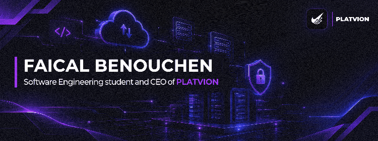

   

   
   

   
  
  
 

 

 
* 🎓 **Education:** Software Engineering at Ibn Zohr University.
* 💼 **Experience:** Delivered 15+ local business systems for companies and 4+ online websites, handling continuous operations, bug fixing, and server maintenance.
* 🚀 **Roots:** Started early developing hardware logic with Arduino before scaling into full-stack web architectures and system engineering.
* 📫 **Reach me:** Discord at **`scrxll.exe`**

 

 
| Project | What it is | Built with |
| :--- | :--- | :--- |
| **La Casa Beauty Center** | Client reservation system, automated booking, and admin management | PHP · Laravel · MySQL |
| **Foodi** | Containerized web application for food delivery operations | React · Laravel · Docker |
| **AgriLyx (Smart Farm)** | Smart farming multi-tenant organization platform (Currently building) | PHP · React · Zero-Trust |
| **BeActiveFootball** | Local match inscription platform in Rabat for players to search teams and join | Web Stack · Database |
| **Gym Management System** | Internal local tracking system for gym memberships and schedules | Web Stack · Tailwind |
| **Laundry Local System** | Operations and order tracking system for a local laundry business | Web Stack · Bootstrap |
| **FiveM Roleplay Servers** | Custom GTA V multiplayer server development, economy, and logic | Lua · QBCore · ESX |

 

### 💻 Tech Stack

      

     

     

 

 

  
  

